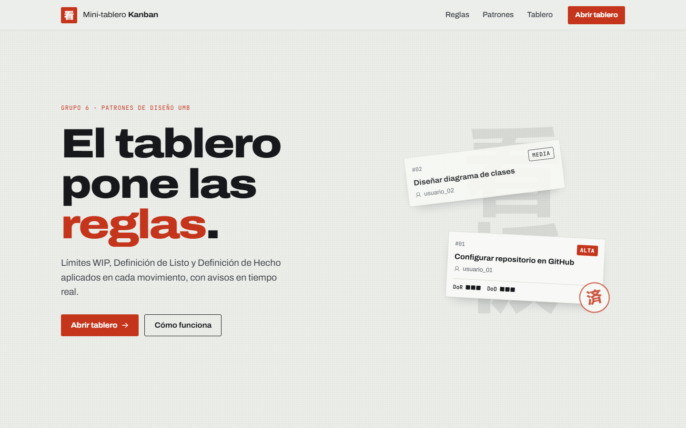

# Mini-tableroKanban

   

**Grupo 6** · Proyecto académico de la asignatura **Patrones de Diseño**, Universidad Manuela Beltrán, Ingeniería de Software.



---

## 1. Descripción

Mini-tableroKanban es una aplicación web que representa un mini-tablero Kanban de cuatro columnas
(Por hacer → En curso → Revisión → Hecho). Permite a un equipo ágil pequeño visualizar su flujo de trabajo,
controlar el trabajo en progreso mediante límites WIP configurables y garantizar la calidad con listas de chequeo de
Definición de Listo (DoR) y Definición de Hecho (DoD).

Las reglas del flujo se implementan con el patrón **Strategy** y los avisos al equipo con el patrón **Observer**.

## 2. Objetivo

Desarrollar una aplicación web de mini-tablero Kanban que permita gestionar el ciclo de vida de las tareas de un
equipo ágil, aplicando las reglas de Kanban y Scrum (límites WIP, DoR y DoD) mediante los patrones
Observer y Strategy, para obtener un código mantenible, extensible y fácil de probar.

## 3. Problema que busca resolver

Los equipos pequeños que trabajan con metodologías ágiles suelen:

- Perder visibilidad del estado real de sus tareas.
- Sobrecargarse iniciando más trabajo del que pueden terminar.
- Dar por terminadas tareas incompletas, sin criterios de calidad acordados.

Mini-tableroKanban ataca estos problemas mostrando el flujo en un tablero, bloqueando movimientos que superen el límite WIP
y exigiendo checklists de DoR/DoD antes de iniciar o cerrar una tarea.

## 4. Alcance

| Incluye | No incluye |
|---|---|
| Tablero con 4 columnas de flujo | Base de datos o persistencia permanente (el estado vive en memoria) |
| Crear, editar y eliminar tareas | Inicio de sesión, roles o trabajo multiusuario |
| Límites WIP configurables por columna | Despliegue en la nube o aplicación móvil nativa |
| Checklists de DoR y DoD | Integración con Jira, Trello o correo electrónico |
| Notificaciones en tiempo real en el tablero | Métricas avanzadas (burndown, lead time) |
| Pruebas automatizadas y diagramas UML | |

**Hasta dónde llega:** prototipo funcional para un solo equipo, ejecutado en el navegador.

## 5. Funcionalidades implementadas

| Funcionalidad | Desde | Patrón |
|---|---|---|
| Crear tareas con título, descripción, responsable y prioridad, validando los datos | Entrega 1 | — |
| Mover tareas entre columnas con `←` y `→` | Entrega 1 | Strategy |
| Bloquear movimientos que superan el límite WIP | Entrega 1 (rehecho en la 2) | Strategy |
| **Editar** tareas existentes (`✎`) | Entrega 2 | Observer |
| **Eliminar** tareas con confirmación | Entrega 2 | Observer |
| **Checklists DoR y DoD** en cada tarjeta, con progreso (por ejemplo `DoR 2/3`) | Entrega 2 | — |
| Exigir la **DoR completa** para pasar a "En curso" | Entrega 2 | Strategy |
| Exigir la **DoD completa** para pasar a "Hecho" | Entrega 2 | Strategy |
| Impedir saltarse columnas | Entrega 2 | Strategy |
| **Configurar el límite WIP** de cada columna desde su encabezado (vacío = sin límite) | Entrega 2 | Observer |
| **Panel de notificaciones en tiempo real**: creación, edición, movimiento, bloqueos y columnas llenas | Entrega 2 | Observer |
| Mensajes de error claros: qué política bloqueó y qué ítems faltan | Entrega 2 | Strategy + Observer |
| Diseño adaptable a celular | Entrega 2 | — |
| **Página de presentación (landing)** con la explicación de reglas y patrones, y el tablero integrado | Versión final | — |
| **Identidad visual propia** inspirada en el origen japonés de *kanban* (看板, "letrero"), con modo claro y oscuro | Versión final | — |
| Sello 済 en las tareas terminadas y animaciones de entrada, rechazo y cierre | Versión final | Observer |
| **Ejecutable para Windows** que funciona sin instalar Node.js ni tener internet | Versión final | — |

## 6. Tecnologías utilizadas

| Tecnología | Uso |
|---|---|
| HTML5 + CSS3 | Página de presentación y tablero, con modo claro y oscuro |
| Archivo + JetBrains Mono (OFL) y Phosphor Icons (MIT) | Tipografías e íconos, incluidos en `src/assets/` para funcionar sin internet |
| JavaScript (ES6+, módulos ES) | Lógica de dominio, patrones, controlador y vista, sin frameworks |
| Node.js (≥ 18) | Servidor local de desarrollo y ejecución de pruebas |
| Jest | Pruebas unitarias y de integración, con reporte de cobertura |
| Mermaid (UML) | Diagramas de arquitectura, clases y secuencia dentro del repositorio |
| Git + GitHub | Control de versiones y trabajo colaborativo |
| VS Code | Editor de código |

## 7. Estructura actual del proyecto

```
Grupo6_Mini-tableroKanban/
│
├── docs/
│   ├── descripcion_proyecto.md       # Descripción técnica: módulos, responsabilidades, organización
│   ├── patrones/
│   │   ├── observer.md               # Patrón Observer: problema, justificación, código y beneficios
│   │   └── strategy.md               # Patrón Strategy: problema, justificación, código y beneficios
│   ├── diagramas/
│   │   ├── arquitectura.md           # Capas y dependencias
│   │   ├── clases.md                 # Diagrama de clases UML
│   │   └── secuencia_mover_tarea.md  # Cómo colaboran Strategy y Observer al mover una tarea
│   ├── evidencias/
│   │   ├── entrega1/                 # Capturas de la primera entrega
│   │   ├── entrega2/                 # Resultado de pruebas y verificación manual
│   │   └── final/                    # Capturas, pruebas y verificación de la versión final
│   └── presentacion/                 # Presentación final en PowerPoint
│
├── src/
│   ├── index.html                    # Página principal
│   ├── main.js                       # Punto de entrada: crea y conecta los componentes
│   ├── styles.css                    # Identidad visual: tokens de color, tipografía, landing y tablero
│   ├── assets/                       # Fuentes e íconos locales (generados con npm run vendor)
│   ├── domain/                       # Modelos: Task, Column, Board, checklists
│   ├── policies/                     # Strategy: MovePolicy y sus políticas concretas
│   ├── notifier/                     # Observer: EventBus y catálogo de eventos
│   ├── controller/                   # BoardController: puente entre vista y dominio
│   ├── ui/                           # Componentes: BoardView, TaskForm, NotificationPanel, plantillas, landing
│   ├── utils/                        # Utilidades: errores del dominio, escapeHtml
│   └── data/                         # Tareas de ejemplo
│
├── tests/                            # 6 archivos de pruebas Jest + helpers
├── scripts/
│   ├── server.js                     # Servidor estático local para desarrollo (npm start)
│   ├── launcher.cjs                  # Punto de entrada del ejecutable: sirve la app y abre el navegador
│   ├── build-exe.mjs                 # Genera dist/MiniTableroKanban.exe (npm run build:exe)
│   └── vendor-assets.mjs             # Copia fuentes e íconos a src/assets (npm run vendor)
│
├── package.json
├── README.md
└── .gitignore
```

| Carpeta de referencia de la guía | Equivalente en este proyecto |
|---|---|
| `src/modelos/` | `src/domain/` |
| `src/componentes/` | `src/ui/` |
| `src/servicios/` | `src/controller/`, `src/policies/`, `src/notifier/` |
| `src/utilidades/` | `src/utils/` |
| `documentacion/patrones/`, `documentacion/diagramas/` | `docs/patrones/`, `docs/diagramas/` |
| `recursos/` | `src/data/`, `docs/evidencias/` |

## 8. Patrones y decisiones de construcción

### 8.1 Patrón Strategy — políticas de movimiento

**Problema.** Antes de mover una tarea hay que aplicar varias reglas (columnas vecinas, límite WIP, DoR, DoD). Con
`if/else` dentro del tablero, cada regla nueva obligaba a modificar `Board.moveTask()` y no se podían activar o
desactivar por equipo.

**Por qué Strategy.** Todas las reglas reciben lo mismo (tarea, columna origen, columna destino) y responden lo mismo
(permitido o motivo del rechazo): son algoritmos intercambiables. La ficha técnica pide *políticas intercambiables
para WIP, DoR y DoD*.

**Cómo se aplicó.**

- `MovePolicy` es la interfaz: `validate(context)` devuelve `null` o el motivo del rechazo.
- `AdjacentColumnPolicy`, `WipLimitPolicy`, `DefinitionOfReadyPolicy` y `DefinitionOfDonePolicy` son las estrategias
  concretas; DoR y DoD reutilizan `ChecklistPolicy`.
- `Board` recibe la lista de políticas en el constructor y las consulta en `#enforcePolicies()` antes de crear o
  mover una tarea. `addPolicy()` y `removePolicy()` las cambian en tiempo de ejecución.

```js
// src/domain/Board.js — el contexto delega sin conocer las reglas
#enforcePolicies(context) {
  for (const policy of this.policies) {
    const reason = policy.validate({ ...context, board: this });
    if (reason) {
      this.events.publish(EVENTS.MOVE_REJECTED, { ...context, policy: policy.name, reason });
      throw new PolicyViolationError(reason, policy.name);
    }
  }
}
```

**Beneficio.** Una regla nueva es una clase nueva; `Board` no cambia. Cada regla se prueba por separado.
Documentación completa: [`docs/patrones/strategy.md`](docs/patrones/strategy.md).

### 8.2 Patrón Observer — notificaciones en tiempo real

**Problema.** Cuando una tarea cambia, la vista debe redibujarse y el equipo debe recibir un aviso. En la entrega 1
la vista se redibujaba a mano después de cada acción y el controlador armaba los mensajes: cada componente nuevo
obligaba a tocar el código existente.

**Por qué Observer.** Un objeto (el tablero) cambia y varios dependientes deben enterarse sin que el tablero los
conozca. La ficha técnica pide *alertar cuando una tarea cambia de estado o se rebasa un límite de trabajo*.

**Cómo se aplicó.**

- `EventBus` es el sujeto: `subscribe()`, `unsubscribe()` y `publish()`.
- `Board` publica 8 eventos (`task:created`, `task:moved`, `move:rejected`, `wip:reached`…).
- `BoardView` (redibuja) y `NotificationPanel` (muestra el aviso) son los observadores.
- Si un observador falla, los demás siguen recibiendo el evento.

```js
// src/domain/Board.js — el publicador no sabe quién escucha
this.events.publish(EVENTS.TASK_MOVED, { task, from, to });

// src/ui/BoardView.js — un observador
events.subscribe(ANY_EVENT, (event) => {
  if (event.name !== EVENTS.MOVE_REJECTED) this.render();
});
```

**Beneficio.** El dominio no depende de la interfaz y se prueba sin navegador; agregar un aviso nuevo es agregar una
línea en `NotificationPanel`. Documentación completa: [`docs/patrones/observer.md`](docs/patrones/observer.md).

### 8.3 Otras decisiones de construcción

| Decisión | Motivo |
|---|---|
| **Arquitectura por capas** (UI → controlador → dominio) | La vista no contiene reglas de negocio; el dominio se prueba sin navegador. |
| **Inyección de dependencias** en `Board` (políticas y EventBus por constructor) | Permite probar con otras políticas y conectar todo en un solo lugar (`main.js`). |
| **Errores propios** (`DomainError`, `PolicyViolationError`) | El controlador distingue un dato inválido de una regla rechazada y no oculta fallos de programación. |
| **Validación completa antes de modificar** (`Task.update`) | Una edición inválida no deja la tarea a medio cambiar. |
| **Plantillas separadas** (`ui/templates.js`) y `escapeHtml` | Vista más legible; el texto del usuario no se interpreta como HTML. |
| **Constantes de eventos** (`notifier/events.js`) | Evita errores de escritura en nombres de eventos. |
| **Se descartó el patrón Command** | Decisión del equipo para concentrarse en Observer y Strategy; deshacer/rehacer queda fuera del alcance. |

| **JavaScript sin frameworks** | Los patrones quedan visibles en el código y la app corre en cualquier navegador. |
| **Estado en memoria** | El alcance es un prototipo para un equipo; evita una base de datos que no aporta a los patrones. |
| **Ejecutable con Node.js SEA** | Permite demostrar la app con doble clic, sin instalar nada. |
| **Fuentes e íconos locales** (`src/assets/`) | La app y el ejecutable funcionan sin conexión a internet. |

Diagramas: [arquitectura](docs/diagramas/arquitectura.md) · [clases](docs/diagramas/clases.md) ·
[secuencia al mover una tarea](docs/diagramas/secuencia_mover_tarea.md).

### 8.4 Buenas prácticas de desarrollo

| Práctica | Cómo se aplicó |
|---|---|
| **Separación de responsabilidades** | Una clase por regla (`src/policies/`), una por componente de vista (`src/ui/`); la vista no contiene reglas de negocio. |
| **Principio abierto/cerrado** | Reglas nuevas se agregan como políticas y avisos nuevos como suscriptores, sin modificar `Board`. |
| **Reutilización y cero duplicación** | DoR y DoD comparten `ChecklistPolicy`; las validaciones de `Task` están en funciones reutilizadas por constructor y `update`. |
| **Manejo de errores** | `DomainError` y `PolicyViolationError`; el controlador traduce errores esperados y deja ver los de programación. |
| **Pruebas automatizadas** | 60 pruebas con Jest y ~97 % de cobertura de la lógica; cada regla tiene un caso exitoso y uno de error. |
| **Nombres claros** | Clases, métodos y eventos describen lo que hacen (`WipLimitPolicy`, `moveTask`, `wip:reached`). |
| **Control de versiones** | Commits con prefijo (`feat`, `fix`, `refactor`, `test`, `docs`, `chore`) que muestran la evolución por entregas. |
| **Seguridad básica** | `escapeHtml` evita que el texto del usuario se interprete como HTML; los servidores impiden leer archivos fuera de `src/`. |
| **Accesibilidad** | Etiquetas en los campos, `aria-label` en los botones con ícono, avisos con `aria-live`, foco visible y respeto a *reducir movimiento*. |

## 9. Instrucciones de ejecución

**Requisitos:** [Node.js](https://nodejs.org/) 18 o superior y Git.

```bash
git clone https://github.com/Andres-Quijano/Grupo6_Mini-tableroKanban.git
cd Grupo6_Mini-tableroKanban
npm install
```

**Ejecutar la aplicación:**

```bash
npm start
```

Abrir `http://localhost:3000`: primero aparece la página de presentación y, en la sección **Tablero** (botón *Abrir tablero*), la aplicación con tres tareas de ejemplo. Para probar los patrones:

1. Pulsar `→` en *"Definir checklist DoD"*: se bloquea porque su DoR está incompleta (Strategy) y el panel lo avisa (Observer).
2. Desplegar `DoR 1/3` en la tarjeta, marcar los ítems y volver a pulsar `→`: ahora avanza.
3. Escribir `1` en el límite WIP de "Revisión": aparece la advertencia de columna llena.

> Abrir `index.html` con doble clic no funciona porque los módulos ES requieren un servidor; use `npm start`
> o el ejecutable.

**Generar el ejecutable para Windows:**

```bash
npm run build:exe
```

Crea `dist/MiniTableroKanban.exe` (unos 90 MB), que **no necesita Node.js instalado**: al abrirlo con doble clic
levanta el servidor, abre el tablero en el navegador y muestra una ventana de consola; al cerrarla se detiene la
aplicación. Si el puerto 3000 está ocupado usa el siguiente libre (3001, 3002…).

- Se construye con [Single Executable Applications](https://nodejs.org/api/single-executable-applications.html) de
  Node.js: `scripts/build-exe.mjs` empaqueta `scripts/launcher.cjs` y los archivos de `src/` dentro de una copia de
  Node.js.
- El ejecutable funciona en el sistema operativo donde se compiló (compilado en Windows → `.exe` para Windows).
- No está firmado digitalmente: Windows puede mostrar el aviso *"Windows protegió su PC"*. Se abre con
  **Más información → Ejecutar de todas formas**.
- `dist/` no se sube al repositorio por su tamaño; el `.exe` se distribuye aparte (por ejemplo, en *Releases*).

**Ejecutar las pruebas:**

```bash
npm test
```

```bash
npm run test:coverage
```

Resultado: **60 pruebas aprobadas** en 6 archivos, ~97 % de cobertura de la lógica.
Detalle y capturas de la versión final en [`docs/evidencias/final/`](docs/evidencias/final).

## 10. Integrantes del equipo

| Integrante | Rol | Usuario GitHub |
|---|---|---|
| Andrés Felipe Quijano Niño | Desarrollador · Scrum Master | Andres-Quijano |
| Maria Camila Peralta Perez | Colaborador · Scrum Team | mcamip |
| Mateho Quesada Bustos | Colaborador · Scrum Team | maquebus-sys |

## 11. Estado final del proyecto

- [x] Repositorio, estructura de carpetas y documentación.
- [x] Modelo de dominio: `Task`, `Column`, `Board`.
- [x] Crear, editar, mover y eliminar tareas.
- [x] Patrón **Observer**: `EventBus`, 8 eventos, vista y panel de notificaciones como observadores.
- [x] Patrón **Strategy**: políticas de columnas vecinas, límite WIP, DoR y DoD intercambiables.
- [x] Checklists DoR y DoD en cada tarea.
- [x] Límite WIP configurable desde el tablero.
- [x] Diagramas de arquitectura, clases y secuencia.
- [x] 60 pruebas automatizadas aprobadas.
- [x] Página de presentación e identidad visual propia, con modo claro y oscuro.
- [x] Ejecutable para Windows que funciona sin Node.js ni internet.
- [x] Evidencias de funcionamiento de la versión final.

## 12. Evolución del proyecto

| Entrega | Qué se construyó |
|---|---|
| **1** | Repositorio, estructura, documentación inicial y primera versión: crear y mover tareas con límite WIP. |
| **2** | Patrones Strategy y Observer, checklists DoR y DoD, edición de tareas, límite WIP configurable, diagramas UML y 60 pruebas. |
| **Final** | Página de presentación, rediseño completo de la interfaz, recursos locales, ejecutable para Windows, evidencias y presentación. |

El historial de commits del repositorio muestra cada paso con su prefijo (`feat`, `refactor`, `test`, `docs`…).

## 13. Trabajo futuro

Ideas que quedan fuera del alcance de la asignatura y que la arquitectura ya facilita:

- Panel para activar o desactivar políticas desde la interfaz (aprovechando `addPolicy` / `removePolicy`).
- Checklists DoR/DoD personalizables por el equipo.
- Filtros por responsable y prioridad.
- Historial de eventos de la sesión (un nuevo observador del `EventBus`).
- Persistencia en el navegador o en una base de datos.
