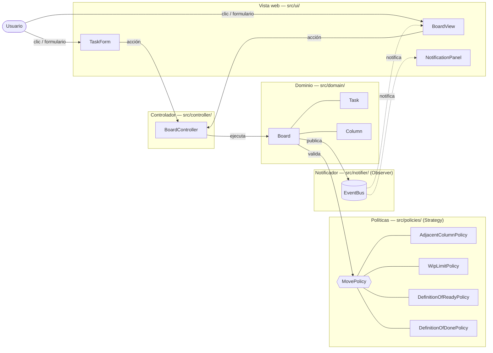

# Diagrama de arquitectura

Arquitectura por capas. Las flechas continuas son llamadas directas; las punteadas, eventos del patrón Observer.

| Capa | Depende de | No depende de |
|---|---|---|
| Vista | Controlador, EventBus | Políticas |
| Controlador | Dominio | Vista |
| Dominio | Políticas, EventBus | Vista, Controlador |
| Políticas | Dominio (solo lectura) | Vista, EventBus |
