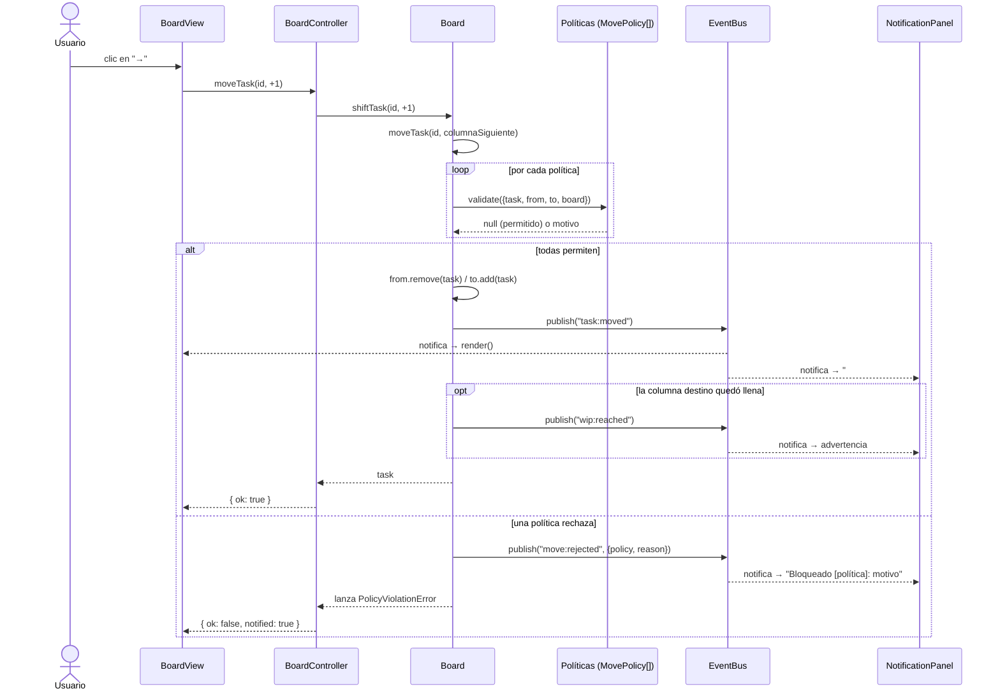

# Diagrama de secuencia — Mover una tarea

Muestra cómo colaboran los dos patrones cuando el usuario pulsa → en una tarjeta:
Strategy decide si el movimiento se permite y Observer avisa a la interfaz del resultado.

