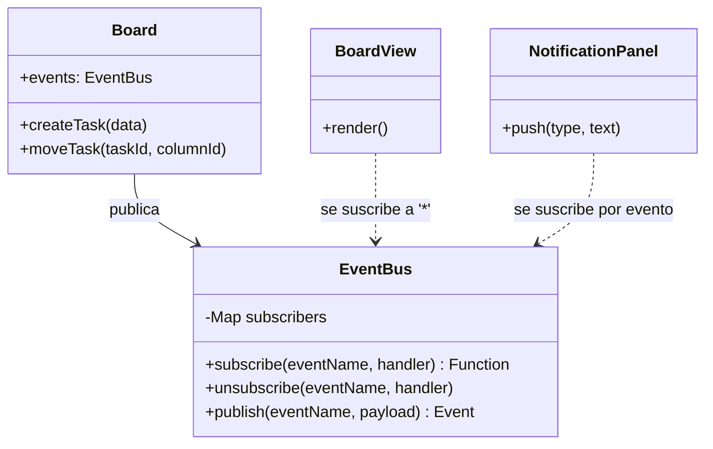

# Patrón Observer — Notificaciones del tablero

| | |
|---|---|
| **Tipo** | Patrón de comportamiento (GoF) |
| **Carpeta** | [`src/notifier/`](../../src/notifier) |
| **Sujeto** | `EventBus` |
| **Observadores** | `BoardView`, `NotificationPanel` |
| **Publicador** | `Board` |

## 1. Problema que resuelve

Cada vez que una tarea cambia (se crea, se edita, se mueve, se elimina, se marca un checklist o se llena una columna)
varias partes de la aplicación tienen que enterarse:

- el **tablero** debe redibujarse;
- el **panel de notificaciones** debe mostrar un mensaje al equipo;
- en el futuro, otros componentes (métricas, historial, sonido…) también querrán reaccionar.

En la primera entrega la vista se redibujaba **a mano** después de cada acción y los mensajes los armaba el
controlador. Eso acoplaba las piezas: el controlador tenía que saber qué mostrar y la vista tenía que acordarse de
redibujar. Cada componente nuevo obligaba a modificar el código existente.

## 2. Justificación de la selección

- La ficha técnica pide **notificaciones en tiempo real** cuando una tarea cambia de estado o se rebasa un límite WIP.
  Es exactamente el caso de uso de Observer: *un objeto cambia y varios dependientes deben enterarse*.
- Permite que el dominio (`Board`) **no conozca la interfaz**, de modo que se pueda probar con Jest sin navegador.
- Los observadores se agregan o quitan sin tocar al publicador (principio abierto/cerrado).
- Alternativas descartadas: llamar directamente a la vista desde `Board` (acopla el dominio a la UI) o hacer que la
  vista consulte el tablero cada cierto tiempo (*polling*, desperdicia recursos y no es inmediato).

## 3. Cómo se aplicó

Se usó la variante **publicar/suscribir** con un bus de eventos:

1. `EventBus` guarda, por cada nombre de evento, el conjunto de funciones suscritas.
2. `Board` recibe el `EventBus` en su constructor y, al terminar cada operación, llama a `publish(evento, datos)`.
3. `BoardView` se suscribe a **todos** los eventos (`'*'`) y se redibuja.
4. `NotificationPanel` se suscribe a cada evento del catálogo y lo convierte en un mensaje con su color
   (éxito, información, advertencia o error).
5. Si un observador falla, el `EventBus` captura el error y **los demás siguen recibiendo el evento**.

### Eventos publicados ([`events.js`](../../src/notifier/events.js))

| Evento | Cuándo se publica | Datos |
|---|---|---|
| `task:created` | Se crea una tarea | `task`, `column` |
| `task:updated` | Se edita una tarea | `task`, `changes` |
| `task:moved` | Una tarea cambia de columna | `task`, `from`, `to` |
| `task:deleted` | Se elimina una tarea | `task`, `column` |
| `checklist:toggled` | Se marca o desmarca un ítem DoR/DoD | `task`, `type`, `item` |
| `move:rejected` | Una política (Strategy) bloquea un movimiento | `task`, `from`, `to`, `policy`, `reason` |
| `wip:changed` | Se cambia el límite WIP de una columna | `column` |
| `wip:reached` | Una columna llega a su límite WIP | `column` |

## 4. Componentes involucrados



| Rol del patrón | Clase | Archivo |
|---|---|---|
| Sujeto (*Subject*) | `EventBus` | [`src/notifier/EventBus.js`](../../src/notifier/EventBus.js) |
| Publicador | `Board` | [`src/domain/Board.js`](../../src/domain/Board.js) |
| Observador concreto | `BoardView` | [`src/ui/BoardView.js`](../../src/ui/BoardView.js) |
| Observador concreto | `NotificationPanel` | [`src/ui/NotificationPanel.js`](../../src/ui/NotificationPanel.js) |
| Composición | `main.js` conecta todo | [`src/main.js`](../../src/main.js) |

## 5. Código de la implementación

**Sujeto** — registrar y notificar observadores (`src/notifier/EventBus.js`):

```js
subscribe(eventName, handler) {
  if (!this.#subscribers.has(eventName)) this.#subscribers.set(eventName, new Set());
  this.#subscribers.get(eventName).add(handler);
  return () => this.unsubscribe(eventName, handler);
}

publish(eventName, payload = {}) {
  const event = { name: eventName, payload, timestamp: new Date() };
  const handlers = [...this.#handlersOf(eventName), ...this.#handlersOf(ANY_EVENT)];
  for (const handler of handlers) {
    try {
      handler(event);
    } catch (error) {
      this.#onError(error, event);   // un observador que falla no afecta a los demás
    }
  }
  return event;
}
```

**Publicador** — el tablero anuncia el cambio sin saber quién escucha (`src/domain/Board.js`):

```js
from.remove(taskId);
to.add(task);
this.events.publish(EVENTS.TASK_MOVED, { task, from, to });
this.#announceIfFull(to);
```

**Observadores** — la vista y el panel reaccionan (`src/ui/BoardView.js`, `src/ui/NotificationPanel.js`):

```js
// BoardView: redibuja con cualquier cambio
events.subscribe(ANY_EVENT, (event) => {
  if (event.name !== EVENTS.MOVE_REJECTED) this.render();
});

// NotificationPanel: un formateador por evento
[EVENTS.WIP_LIMIT_REACHED]: ({ column }) => [
  'warning',
  `"${column.name}" llegó a su límite WIP (${column.wipLimit}). Terminen tareas antes de iniciar otras.`,
],
```

## 6. Beneficios obtenidos

| Beneficio | Evidencia en el proyecto |
|---|---|
| **Bajo acoplamiento** | `Board` no importa nada de `src/ui/`; solo conoce el `EventBus`. |
| **Extensible** | Para notificar un evento nuevo basta con agregar una línea en `MESSAGES` de `NotificationPanel`. |
| **Probable sin navegador** | `tests/eventBus.test.js` y `tests/board.test.js` verifican los eventos con Jest. |
| **Menos código repetido** | Ya no hay llamadas a `render()` dispersas después de cada acción. |
| **Robustez** | Un observador con errores no detiene a los demás (prueba *"si un suscriptor falla…"*). |

## 7. Pruebas relacionadas

- [`tests/eventBus.test.js`](../../tests/eventBus.test.js): suscribir, publicar, cancelar, comodín `'*'`, aislamiento de
  errores.
- [`tests/board.test.js`](../../tests/board.test.js) → *eventos publicados (Observer)*: orden de eventos por operación,
  `move:rejected` y `wip:reached`.
