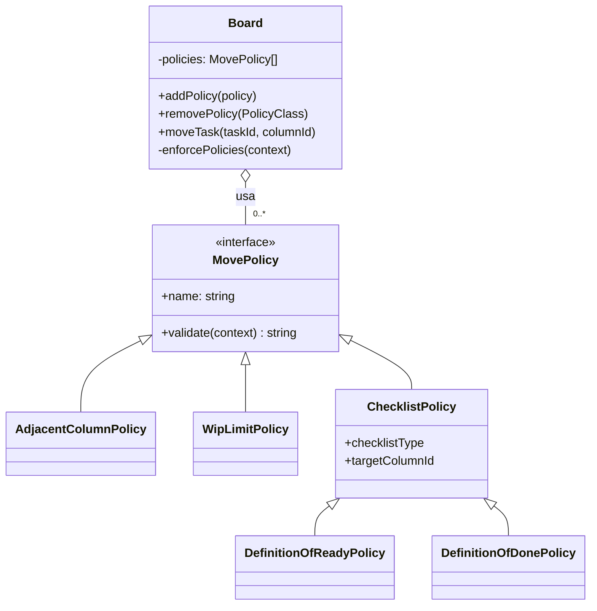

# Patrón Strategy — Políticas de movimiento (WIP, DoR, DoD)

| | |
|---|---|
| **Tipo** | Patrón de comportamiento (GoF) |
| **Carpeta** | [`src/policies/`](../../src/policies) |
| **Contexto** | `Board` |
| **Estrategia (interfaz)** | `MovePolicy` |
| **Estrategias concretas** | `AdjacentColumnPolicy`, `WipLimitPolicy`, `DefinitionOfReadyPolicy`, `DefinitionOfDonePolicy` |

## 1. Problema que resuelve

Antes de mover una tarea el tablero debe aplicar varias reglas de Kanban y Scrum:

- no saltarse columnas;
- no superar el **límite WIP** de la columna destino;
- no empezar una tarea sin cumplir la **Definición de Listo (DoR)**;
- no cerrar una tarea sin cumplir la **Definición de Hecho (DoD)**.

En la primera entrega dos de estas reglas estaban escritas con `if` dentro de `Board.moveTask()`. Seguir así habría
convertido ese método en una cadena de condicionales que crece con cada regla nueva, difícil de leer, de probar por
separado y de activar o desactivar según el equipo.

## 2. Justificación de la selección

- Cada regla es un **algoritmo de validación intercambiable** con la misma entrada (tarea, columna origen, columna
  destino) y la misma salida (permitido o motivo del rechazo): es el caso típico de Strategy.
- La ficha técnica pide **políticas intercambiables para validar WIP, DoR y DoD**.
- Cada equipo puede querer reglas distintas (por ejemplo, sin DoD en un prototipo). Con Strategy basta con cambiar la
  lista de políticas que recibe el tablero.
- Alternativas descartadas: `if/else` dentro de `Board` (viola abierto/cerrado) y herencia de `Board` por cada
  combinación de reglas (explosión de subclases).

## 3. Cómo se aplicó

1. `MovePolicy` define la interfaz común: `validate({ task, from, to, board })` devuelve `null` si el movimiento se
   permite o un texto con el motivo del rechazo.
2. Cada regla es una clase concreta que implementa `validate()`.
3. `DefinitionOfReadyPolicy` y `DefinitionOfDonePolicy` heredan de `ChecklistPolicy`, que contiene la lógica común
   ("este checklist debe estar completo para entrar a esta columna"); así no se duplica código.
4. `Board` recibe la lista de políticas en su constructor (`createDefaultPolicies()` por defecto) y, antes de crear o
   mover una tarea, las recorre en `#enforcePolicies()`. La primera que rechace detiene la operación.
5. Cuando una política rechaza, el tablero publica `move:rejected` (patrón Observer) y lanza
   `PolicyViolationError`; el panel de notificaciones muestra qué política bloqueó y por qué.
6. Las políticas se pueden cambiar en tiempo de ejecución con `board.addPolicy()` y `board.removePolicy()`.

## 4. Componentes involucrados



| Rol del patrón | Clase | Archivo |
|---|---|---|
| Contexto | `Board` | [`src/domain/Board.js`](../../src/domain/Board.js) |
| Estrategia (interfaz) | `MovePolicy` | [`src/policies/MovePolicy.js`](../../src/policies/MovePolicy.js) |
| Estrategia concreta | `AdjacentColumnPolicy` | [`src/policies/AdjacentColumnPolicy.js`](../../src/policies/AdjacentColumnPolicy.js) |
| Estrategia concreta | `WipLimitPolicy` | [`src/policies/WipLimitPolicy.js`](../../src/policies/WipLimitPolicy.js) |
| Estrategia base reutilizable | `ChecklistPolicy` | [`src/policies/ChecklistPolicy.js`](../../src/policies/ChecklistPolicy.js) |
| Estrategias concretas | `DefinitionOfReadyPolicy`, `DefinitionOfDonePolicy` | [`src/policies/ChecklistPolicy.js`](../../src/policies/ChecklistPolicy.js) |
| Fábrica de la configuración por defecto | `createDefaultPolicies()` | [`src/policies/index.js`](../../src/policies/index.js) |

## 5. Código de la implementación

**Interfaz de la estrategia** (`src/policies/MovePolicy.js`):

```js
export class MovePolicy {
  get name() { return this.constructor.name; }

  /** @returns {string|null} motivo del rechazo, o null si el movimiento se permite. */
  validate(context) {
    throw new Error(`${this.name} debe implementar validate().`);
  }
}
```

**Estrategia concreta** (`src/policies/WipLimitPolicy.js`):

```js
export class WipLimitPolicy extends MovePolicy {
  get name() { return 'Límite WIP'; }

  validate({ to }) {
    if (to.hasCapacity()) return null;
    return `"${to.name}" alcanzó su límite WIP (${to.wipLimit}).`;
  }
}
```

**Contexto** — el tablero delega sin conocer las reglas (`src/domain/Board.js`):

```js
#enforcePolicies(context) {
  for (const policy of this.policies) {
    const reason = policy.validate({ ...context, board: this });
    if (reason) {
      this.events.publish(EVENTS.MOVE_REJECTED, { ...context, policy: policy.name, reason });
      throw new PolicyViolationError(reason, policy.name);
    }
  }
}
```

**Intercambio de estrategias**:

```js
const board = new Board({ policies: createDefaultPolicies() }); // configuración normal
board.removePolicy(DefinitionOfDonePolicy);                      // un equipo sin DoD
board.addPolicy(new HighPriorityFirstPolicy());                  // una regla nueva
```

## 6. Beneficios obtenidos

| Beneficio | Evidencia en el proyecto |
|---|---|
| **Abierto/cerrado** | La prueba *"se puede crear una política nueva sin modificar el tablero"* agrega una regla sin tocar `Board`. |
| **Responsabilidad única** | Cada archivo de `src/policies/` contiene una sola regla, de 10 a 30 líneas. |
| **Reutilización** | DoR y DoD comparten `ChecklistPolicy`; solo cambian el checklist y la columna. |
| **Configurable** | `removePolicy()` y `addPolicy()` activan o desactivan reglas en tiempo de ejecución. |
| **Pruebas aisladas** | `tests/policies.test.js` prueba cada estrategia con un tablero sin otras políticas. |
| **Mensajes claros** | El rechazo indica la política responsable y qué ítems faltan del checklist. |

## 7. Pruebas relacionadas

- [`tests/policies.test.js`](../../tests/policies.test.js): cada política por separado y la creación de una política nueva.
- [`tests/board.test.js`](../../tests/board.test.js) → *políticas intercambiables (Strategy)* y *flujo completo
  Por hacer → Hecho*.
